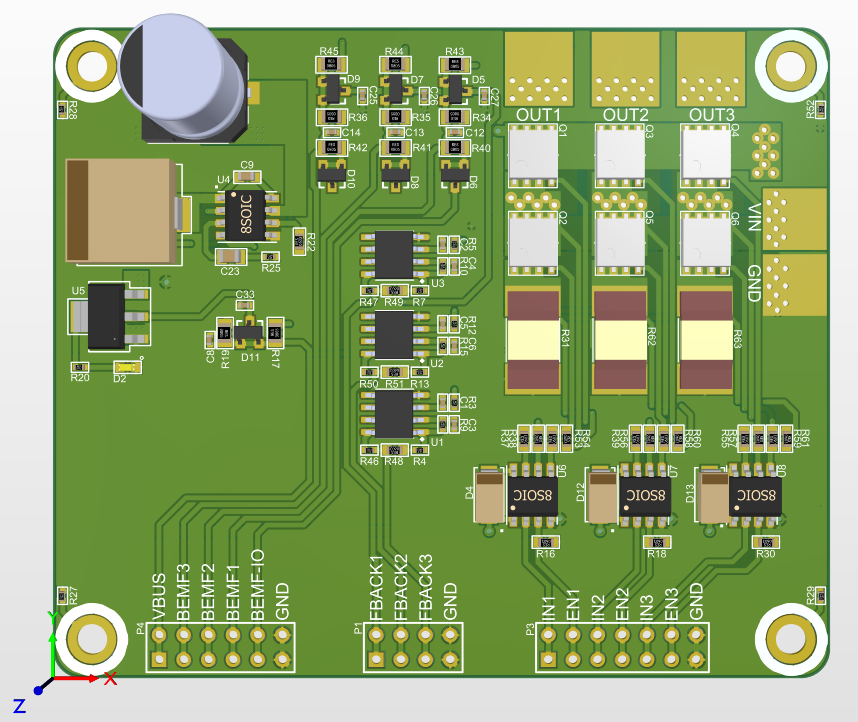
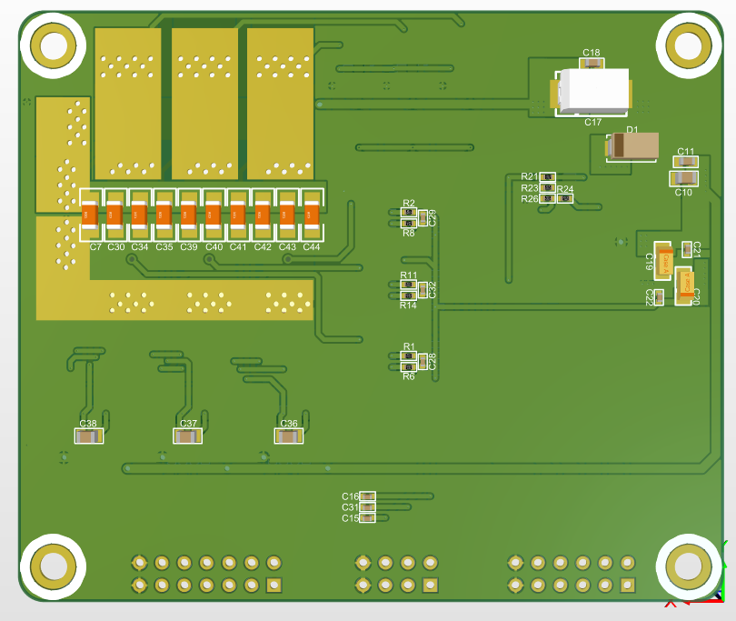

# طراحی برد توسعه و تست الگوریتم‌های BLDC ESC

## معرفی پروژه

این پروژه شامل طراحی و توسعه یک برد اختصاصی برای راه‌اندازی، توسعه و تست الگوریتم‌های کنترلی موتورهای براشلس (BLDC) و کنترلرهای سرعت الکترونیکی (ESC) است.

این برد با هدف ایجاد یک پلتفرم سخت‌افزاری مستقل برای توسعه الگوریتم‌های کنترل موتور طراحی شده و تمامی بخش‌های سخت‌افزاری شامل مدار قدرت، Gate Driver و مدارهای اندازه‌گیری جریان و Back-EMF به‌صورت اختصاصی طراحی شده‌اند.

در این پروژه، یک میکروکنترلر STM32 به برد متصل شده و الگوریتم AM32 برای کنترل موتور و ارزیابی عملکرد سخت‌افزار مورد استفاده قرار گرفته است.

## قابلیت‌ها و مشخصات فنی

- **حداکثر جریان خروجی:** قابلیت پشتیبانی از جریان تا 100A.
- **ولتاژ کاری:** پشتیبانی از باتری‌های لیتیومی تا 6 سلول (6S).
- **ساختار قدرت سه‌فاز:** طراحی اختصاصی Power Stage مبتنی بر MOSFET برای کنترل موتورهای BLDC.
- **طراحی Gate Driver:** انتخاب قطعات و طراحی مدارهای راه‌انداز گیت MOSFET به‌صورت اختصاصی.
- **اندازه‌گیری Back-EMF:** طراحی مدار اندازه‌گیری مستقل برای هر سه فاز موتور.
- **اندازه‌گیری جریان فازها:** استفاده از مقاومت‌های Shunt برای اندازه‌گیری مستقل جریان هر فاز.
- **فیلترینگ سیگنال‌های آنالوگ:** طراحی فیلترهای اختصاصی برای بهبود کیفیت سیگنال‌های Back-EMF و جریان فازها.
- **پردازنده کنترلی:** استفاده از میکروکنترلر STM32.
- **الگوریتم تست‌شده:** AM32.

## ملاحظات و چالش‌های طراحی سخت‌افزار

با توجه به جریان بالای عبوری از مدار قدرت و حساسیت سیگنال‌های اندازه‌گیری در کنترل موتورهای BLDC، بخش مهمی از طراحی این پروژه به مدیریت نویز، بهینه‌سازی مدار قدرت و دستیابی به اندازه‌گیری دقیق پارامترهای الکتریکی اختصاص داشته است.

مهم‌ترین ملاحظات طراحی عبارت‌اند از:

### 1. طراحی مدار قدرت (Power Stage)

- انتخاب و طراحی مدار قدرت سه‌فاز مبتنی بر MOSFET با قابلیت پشتیبانی از جریان تا 100 آمپر.
- انتخاب و طراحی Gate Driver متناسب با مشخصات الکتریکی MOSFETها.
- توجه به مسیرهای جریان بالا و بهینه‌سازی طراحی PCB برای کاهش مقاومت مسیرها و تلفات توان.
- توجه به الزامات سوئیچینگ سریع MOSFETها و مدیریت نویز ناشی از عملکرد مدار قدرت.

### 2. طراحی مدار اندازه‌گیری Back-EMF

- طراحی مدار اندازه‌گیری اختصاصی برای هر یک از سه فاز موتور.
- طراحی فیلترهای آنالوگ برای کاهش نویز ناشی از سوئیچینگ مدار قدرت.
- توجه به دقت و کیفیت سیگنال‌های اندازه‌گیری‌شده برای تشخیص وضعیت موتور.
- فراهم‌کردن سیگنال‌های مناسب برای استفاده در الگوریتم‌های کنترلی مبتنی بر Back-EMF.

### 3. طراحی مدار اندازه‌گیری جریان فازها

- استفاده از مقاومت‌های Shunt برای اندازه‌گیری جریان هر یک از سه فاز به‌صورت مستقل.
- طراحی مدارهای اندازه‌گیری و تقویت سیگنال جریان.
- طراحی فیلترهای آنالوگ برای کاهش نویز و بهبود کیفیت سیگنال‌های اندازه‌گیری.
- توجه به دقت اندازه‌گیری جریان در شرایط سوئیچینگ سریع مدار قدرت.

### 4. یکپارچه‌سازی سخت‌افزار و Firmware

- طراحی بستر سخت‌افزاری برای اتصال و راه‌اندازی میکروکنترلر STM32.
- توسعه نرم‌افزار موردنیاز برای راه‌اندازی و تست سیستم.
- راه‌اندازی و آزمایش الگوریتم AM32 روی سخت‌افزار طراحی‌شده.
- بررسی عملکرد مدارهای اندازه‌گیری و بخش قدرت در فرآیند تست موتور.

## تصاویر سه‌بعدی طراحی PCB

### نمای روی برد (Top View)

### نمای زیر برد (Bottom View)

## ابزارهای طراحی و توسعه

- Altium Designer
- STM32CubeMX
- Keil MDK

## حوزه‌های تخصصی

Hardware Design | Power Electronics | BLDC Motor Control | ESC Design | MOSFET Gate Driver | Current Sensing | Shunt Current Measurement | Back-EMF Sensing | Analog Signal Filtering | PCB Design | STM32 | Embedded Systems | Firmware Development
