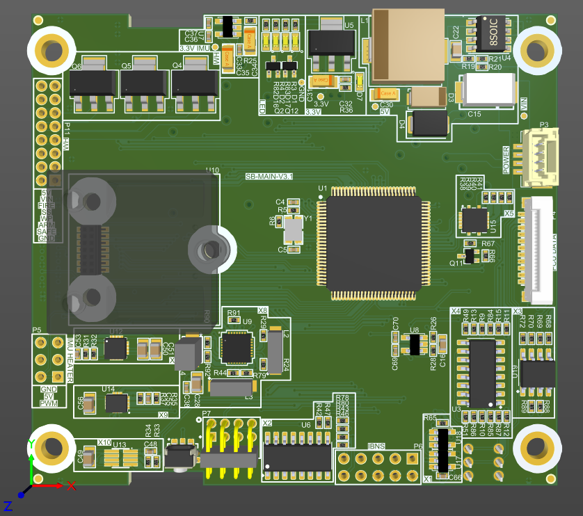
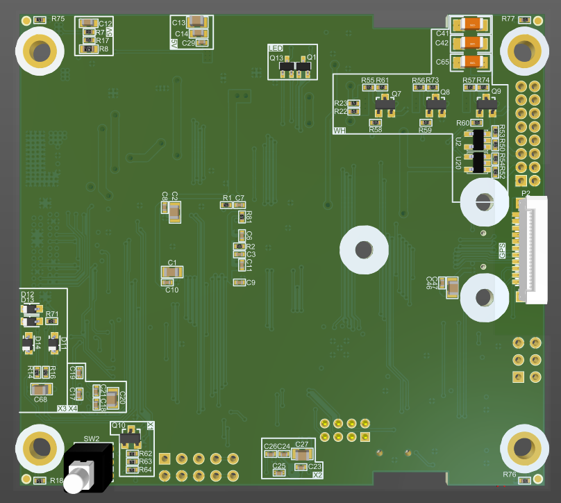

# Flight Control Unit – Flight Computer

## معرفی پروژه

این پروژه شامل طراحی و توسعه یک واحد کنترل پرواز (Flight Control Unit) برای سیستم‌های ناوبری و کنترل پرواز است. این واحد با استفاده از میکروکنترلر خانواده **STM32H7** طراحی شده و وظیفه دریافت اطلاعات از سنسورها، برقراری ارتباط با تجهیزات جانبی و کنترل عملگرهای مختلف را بر عهده دارد.

در طراحی این سیستم، قابلیت اطمینان، افزونگی سنسورها، تفکیک بخش‌های تغذیه و مدیریت خطا در سطح سخت‌افزار و نرم‌افزار مورد توجه قرار گرفته است.

طراحی سخت‌افزار و توسعه بخش‌های ارتباطی و کنترلی نرم‌افزار Embedded این پروژه توسط من انجام شده است.

## قابلیت‌ها و مشخصات سخت‌افزاری

- استفاده از میکروکنترلر **STM32H7 Series**
- پشتیبانی از دو سنسور IMU به‌صورت Primary و Secondary
- پشتیبانی از دو سنسور Magnetometer به‌صورت Primary و Secondary
- استفاده از سنسور Barometer برای اندازه‌گیری فشار و ارتفاع
- امکان اتصال گیرنده‌های GNSS خانواده **u-blox ZED-F9**
- دارای ۵ پورت ارتباطی Serial برای اتصال تجهیزات خارجی
- پشتیبانی از کنترل سرووموتورها (Servo Motor Control)
- پشتیبانی از کنترل موتورهای براشلس (Brushless Motor Control)
- استفاده از MOSFET Switch با قابلیت سوئیچینگ در سطح ولتاژ ۲۷ ولت
- طراحی ورودی‌ها و خروجی‌های ایزوله (Isolated I/O)
- طراحی بخش‌های تغذیه مجزا برای زیرسیستم‌های مختلف

## توسعه نرم‌افزار Embedded

بخش نرم‌افزار این پروژه با زبان C و برای میکروکنترلر STM32H7 توسعه داده شده است.

مسئولیت توسعه لایه‌های ارتباطی و کنترلی سطح پایین و همچنین مدیریت برخی عملکردهای حفاظتی سیستم بر عهده من بوده است.

مهم‌ترین بخش‌های توسعه‌یافته عبارت‌اند از:

- طراحی و پیاده‌سازی ساختار نرم‌افزار مبتنی بر **State Machine**
- توسعه درایورها و لایه‌های ارتباطی موردنیاز برای تبادل اطلاعات با سنسورها و تجهیزات جانبی
- پیاده‌سازی مدیریت ارتباطات سخت‌افزاری و دریافت و ارسال داده‌ها
- پیاده‌سازی مکانیزم‌های **Fault Detection** برای تشخیص خطاهای سنسورها و ارتباطات
- طراحی و پیاده‌سازی منطق **Fail-Safe** برای مدیریت شرایط خطا و انتقال سیستم به وضعیت ایمن
- استفاده از **DMA** برای انتقال داده‌ها و کاهش بار پردازشی CPU
- استفاده از حافظه Cache داخلی میکروکنترلر برای بهبود عملکرد و افزایش سرعت پردازش
- بهینه‌سازی ساختار نرم‌افزار با هدف کاهش تأخیر و استفاده مؤثرتر از منابع پردازشی

**نکته:** توسعه الگوریتم اصلی کنترل پرواز و ناوبری (Flight Control Algorithm) جزو مسئولیت‌های من در این پروژه نبوده است.

## ملاحظات طراحی سخت‌افزار

در طراحی سخت‌افزار این واحد، موارد زیر مورد توجه قرار گرفته‌اند:

- در نظر گرفتن افزونگی سنسورهای IMU و Magnetometer برای افزایش قابلیت اطمینان سیستم
- تفکیک بخش‌های تغذیه برای کاهش اثر نویز و تداخل بین زیرسیستم‌ها
- طراحی رابط‌های ارتباطی متعدد برای اتصال سنسورها و تجهیزات خارجی
- استفاده از ورودی‌ها و خروجی‌های ایزوله برای افزایش حفاظت الکتریکی
- طراحی مدارهای راه‌انداز و کنترلی موردنیاز برای سرووموتورها و موتورهای براشلس
- توجه به یکپارچگی سیگنال و ملاحظات نویز در طراحی PCB

## تصاویر طراحی

### نمای سه‌بعدی برد

**نمای بالا (Top View)**

**نمای پایین (Bottom View)**

## ابزارها و تکنولوژی‌های مورد استفاده

| بخش | ابزار / تکنولوژی |
|---|---|
| طراحی سخت‌افزار و PCB | Altium Designer |
| میکروکنترلر | STM32H7 |
| توسعه Firmware | C / Embedded C |
| پیکربندی میکروکنترلر | STM32CubeMX |
| کامپایل و دیباگ | Keil MDK |
| ساختار نرم‌افزار | State Machine |
| مدیریت انتقال داده | DMA |
| سیستم‌های ارتباطی | UART / Serial Interfaces |

## حوزه‌های تخصصی مرتبط

`Embedded Systems` `STM32` `STM32H7` `Hardware Design` `PCB Design` `Flight Computer` `Flight Control Unit` `Sensor Interface` `GNSS` `IMU` `Magnetometer` `Barometer` `DMA` `Fault Detection` `Fail-Safe` `Motor Control` `Altium Designer`
