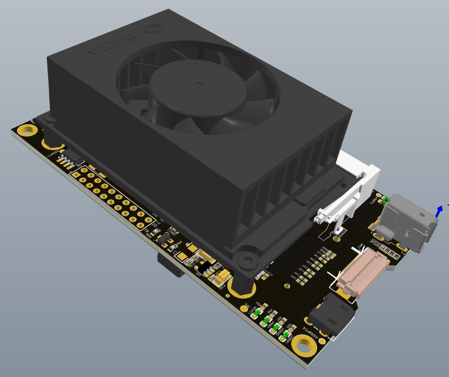
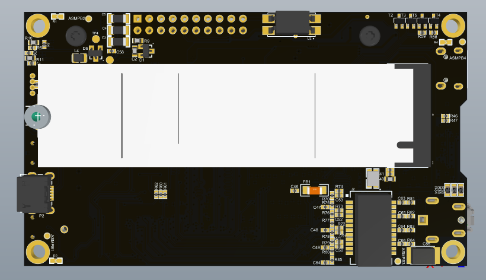

# NVIDIA Jetson Orin Nano Carrier Board

## معرفی پروژه

این پروژه شامل طراحی و توسعه یک Carrier Board اختصاصی برای ماژول پردازشی NVIDIA Jetson Orin Nano است که با هدف توسعه قابلیت‌های ارتباطی، اتصال تجهیزات جانبی و فراهم‌کردن بستر مناسب برای پردازش‌های سنگین طراحی شده است.

در این پروژه، علاوه بر توسعه رابط‌های ارتباطی مختلف، تمرکز ویژه‌ای بر طراحی PCB و رعایت الزامات سیگنال‌های پرسرعت (High-Speed Signals) داشته‌ام.

طراحی سخت‌افزار با مطالعه مستندات فنی ماژول و رابط‌های مورد استفاده انجام شده و ملاحظاتی مانند طراحی Stackup، کنترل امپدانس، تطبیق طول مسیرها (Length Tuning) و Via Stitching در فرآیند طراحی PCB لحاظ شده‌اند.

یکی از چالش‌های اصلی این پروژه، پیاده‌سازی طراحی High-Speed در یک PCB چهارلایه بود؛ در حالی که با توجه به الزامات طراحی، استفاده از ساختار شش‌لایه گزینه مناسب‌تری محسوب می‌شد. با هدف کاهش هزینه تولید، ساختار چهارلایه انتخاب و طراحی با در نظر گرفتن محدودیت‌های آن بهینه‌سازی شد.

همچنین یک مدار تغذیه اختصاصی با ورودی تا 36 ولت طراحی شده است که امکان تأمین ریل‌های تغذیه موردنیاز Jetson و تجهیزات جانبی را فراهم می‌کند. طراحی این بخش با هدف پشتیبانی از حالت پردازشی رسمی MAXN SUPER انجام شده است.

## قابلیت‌ها و مشخصات فنی

- **ماژول پردازشی:** NVIDIA Jetson Orin Nano
- **تعداد لایه‌های PCB:** چهار لایه (4-Layer PCB)
- **حداکثر ولتاژ ورودی:** 36V
- **رابط دوربین:** MIPI CSI
- **رابط شبکه:** Gigabit Ethernet (10/100/1000 Mbps)
- **ذخیره‌سازی پرسرعت:** NVMe SSD از طریق PCIe Gen 3
- **رابط ارتباط سریال:** UART برای ارتباط با تجهیزات خارجی
- **مدیریت توان:** مدار تغذیه اختصاصی (Custom Power Supply)
- **حالت پردازشی:** پشتیبانی از MAXN SUPER

### مشخصات منابع تغذیه

| ریل تغذیه | حداکثر جریان | کاربرد |
|---|---:|---|
| 5V | 5A | تغذیه ماژول Jetson |
| 3.3V | 5A | تغذیه تجهیزات جانبی، به‌ویژه NVMe |
| 1.8V | 0.3A | تغذیه بخش‌های موردنیاز سیستم |

## ملاحظات و چالش‌های طراحی سخت‌افزار

### 1. طراحی رابط MIPI CSI

- طراحی رابط اتصال دوربین مبتنی بر MIPI CSI
- رعایت الزامات طراحی سیگنال‌های تفاضلی (Differential Pairs)
- کنترل امپدانس مسیرهای پرسرعت
- تطبیق طول مسیرها و رعایت محدودیت‌های Length Matching
- توجه به یکپارچگی سیگنال (Signal Integrity)

### 2. طراحی رابط PCIe و اتصال NVMe

- توسعه رابط PCIe Gen 3 برای اتصال حافظه پرسرعت NVMe SSD
- رعایت الزامات مسیردهی سیگنال‌های تفاضلی PCIe
- کنترل امپدانس مسیرها متناسب با مشخصات رابط
- انجام Length Tuning برای تطبیق طول مسیرها
- طراحی منبع تغذیه 3.3V با ظرفیت 5A برای تأمین توان موردنیاز NVMe
- توجه به کیفیت مسیرهای پرسرعت و کاهش ناپیوستگی امپدانس

### 3. طراحی رابط Gigabit Ethernet

- طراحی رابط شبکه با پشتیبانی از سرعت 10/100/1000 Mbps
- رعایت الزامات طراحی مسیرهای تفاضلی Ethernet
- توجه به تطبیق امپدانس و طول مسیرها
- رعایت ملاحظات مربوط به Signal Integrity و کاهش نویز

### 4. طراحی Stackup و بهینه‌سازی PCB

با توجه به استفاده از چندین رابط پرسرعت در این پروژه، طراحی ساختار لایه‌های PCB و رعایت الزامات یکپارچگی سیگنال از مهم‌ترین بخش‌های فرآیند طراحی بوده است.

- طراحی PCB چهارلایه با هدف کاهش هزینه تولید در مقایسه با ساختار شش‌لایه
- طراحی ساختار لایه‌های PCB (Layer Stackup Design)
- محاسبه و کنترل امپدانس مسیرهای پرسرعت (Controlled Impedance)
- انجام Length Tuning برای مسیرهای تفاضلی
- استفاده از Via Stitching برای بهبود پیوستگی صفحات زمین و مسیر برگشت جریان
- مدیریت صفحات مرجع سیگنال (Reference Planes)
- توجه به پیوستگی مسیر برگشت جریان (Return Path)
- رعایت ملاحظات مربوط به Signal Integrity و EMI

### 5. طراحی سیستم تغذیه اختصاصی (Custom Power Supply)

یکی از بخش‌های مهم این پروژه، طراحی مدار تغذیه اختصاصی برای تأمین توان موردنیاز ماژول Jetson Orin Nano و تجهیزات جانبی است.

- طراحی مدار تغذیه با قابلیت دریافت ورودی تا 36V
- طراحی ریل 5V با قابلیت تأمین جریان تا 5A برای ماژول Jetson
- طراحی ریل 3.3V با قابلیت تأمین جریان تا 5A، به‌ویژه برای تغذیه NVMe
- طراحی ریل 1.8V با قابلیت تأمین جریان تا 300mA
- طراحی ساختار تغذیه با هدف پشتیبانی از حالت پردازشی رسمی MAXN SUPER
- توجه به پایداری ولتاژ خروجی در شرایط تغییر بار پردازشی
- در نظر گرفتن الزامات مدیریت حرارتی و تلفات توان در طراحی مدار تغذیه

### 6. توسعه رابط‌های ارتباطی و جانبی

- طراحی رابط UART برای ارتباط با دستگاه‌ها و تجهیزات خارجی
- فراهم‌کردن رابط Gigabit Ethernet برای ارتباط شبکه
- طراحی رابط MIPI CSI برای اتصال دوربین
- فراهم‌کردن رابط PCIe Gen 3 برای اتصال حافظه NVMe

## تصاویر سه‌بعدی طراحی PCB

### نمای روی برد (Top View)

### نمای زیر برد (Bottom View)

## ابزارهای طراحی و توسعه

- Altium Designer

## حوزه‌های تخصصی

Hardware Design | NVIDIA Jetson Orin Nano | Carrier Board Design | High-Speed PCB Design | MIPI CSI | PCIe Gen 3 | NVMe | Gigabit Ethernet | Controlled Impedance | Stackup Design | Length Tuning | Via Stitching | Signal Integrity | Return Path Optimization | Custom Power Supply | Power Electronics | MAXN SUPER | Thermal Management | Embedded Systems
