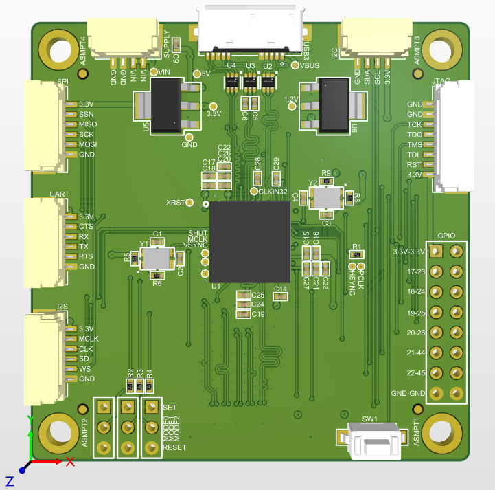
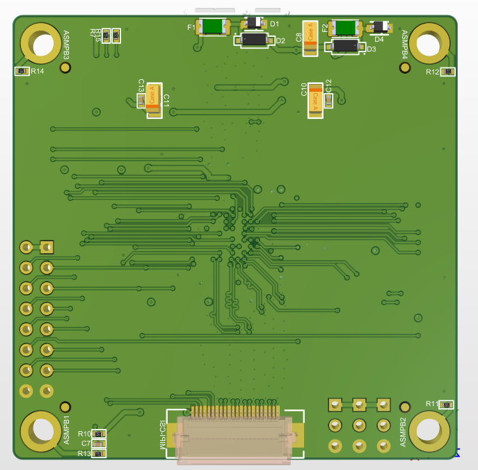

# EZ-USB MIPI CSI to USB 3.0 Converter

## معرفی پروژه

این پروژه شامل طراحی و توسعه یک مبدل سخت‌افزاری برای انتقال داده‌های تصویری از رابط MIPI CSI به رابط USB 3.0، مبتنی بر خانواده کنترلرهای EZ-USB است.

هدف از طراحی این برد، فراهم‌کردن بستری برای دریافت داده‌های تصویری از طریق رابط MIPI CSI و انتقال آن‌ها به سیستم‌های میزبان با استفاده از رابط پرسرعت USB 3.0 بوده است.

در بخش سخت‌افزار، مسئولیت مطالعه و بررسی کامل مستندات فنی چیپ اصلی، طراحی شماتیک و PCB و رعایت الزامات طراحی رابط‌های پرسرعت بر عهده من بوده است. طراحی PCB چهارلایه با در نظر گرفتن Stackup، محاسبات امپدانس و الزامات Signal Integrity برای رابط‌های MIPI CSI و USB 3.0 انجام شده است.

علاوه بر مسئولیت طراحی سخت‌افزار، مدیریت و هدایت بخش نرم‌افزاری پروژه نیز بر عهده من بوده است. این مسئولیت شامل هماهنگی فعالیت‌های توسعه نرم‌افزار، پیگیری روند اجرای کارها و نظارت بر پیشرفت و یکپارچه‌سازی بخش نرم‌افزار با سخت‌افزار طراحی‌شده بوده است. توسعه نرم‌افزار توسط سایر اعضای تیم انجام شده است.

## قابلیت‌ها و مشخصات فنی

- **کنترلر اصلی:** خانواده EZ-USB
- **رابط ورودی تصویر:** MIPI CSI
- **رابط خروجی:** USB 3.0
- **تعداد لایه‌های PCB:** چهار لایه (4-Layer PCB)
- **طراحی سخت‌افزار:** مطالعه مستندات فنی و طراحی اختصاصی مدار
- **طراحی High-Speed PCB:** شامل Stackup Design، Impedance Control و Signal Integrity
- **مدیریت نرم‌افزار:** هدایت و نظارت بر فرآیند توسعه نرم‌افزار پروژه

## ملاحظات و چالش‌های طراحی سخت‌افزار

### 1. مطالعه و بررسی مستندات فنی

- مطالعه کامل دیتاشیت و مستندات فنی کنترلر اصلی EZ-USB
- بررسی ساختار داخلی، بلوک‌های عملکردی و الزامات راه‌اندازی چیپ
- بررسی مشخصات الکتریکی و الزامات اتصال رابط‌های ورودی و خروجی
- طراحی شماتیک بر اساس توصیه‌ها و الزامات ارائه‌شده در مستندات سازنده

### 2. طراحی رابط MIPI CSI

- رعایت الزامات طراحی رابط پرسرعت MIPI CSI
- طراحی و مسیردهی سیگنال‌های تفاضلی (Differential Pairs)
- رعایت الزامات امپدانس کنترل‌شده (Controlled Impedance)
- تطبیق طول مسیرها (Length Matching)
- توجه به یکپارچگی سیگنال (Signal Integrity)

### 3. طراحی رابط USB 3.0

- رعایت الزامات طراحی و مسیردهی رابط پرسرعت USB 3.0
- طراحی مسیرهای تفاضلی با امپدانس کنترل‌شده
- تطبیق طول مسیرها و کاهش ناپیوستگی امپدانس
- رعایت ملاحظات مربوط به یکپارچگی سیگنال و کاهش نویز

### 4. طراحی PCB و Stackup

- طراحی PCB چهار لایه متناسب با الزامات رابط‌های پرسرعت
- تعیین ساختار لایه‌های PCB (Layer Stackup Design)
- محاسبه و تنظیم امپدانس مسیرهای تفاضلی متناسب با ساختار لایه‌ها
- در نظر گرفتن ضخامت لایه‌های دی‌الکتریک و مس در طراحی
- مدیریت مسیرهای سیگنال پرسرعت و صفحات مرجع زمین
- رعایت ملاحظات مربوط به Signal Integrity و کاهش تداخل الکترومغناطیسی

## تصاویر سه‌بعدی طراحی PCB

### نمای روی برد (Top View)

### نمای زیر برد (Bottom View)

## ابزارهای طراحی و توسعه

- Altium Designer

## حوزه‌های تخصصی

Hardware Design | High-Speed PCB Design | EZ-USB | MIPI CSI | USB 3.0 | Differential Pair Routing | Controlled Impedance | Stackup Design | Signal Integrity | PCB Design | Hardware Architecture | Technical Project Management | Software Development Management
