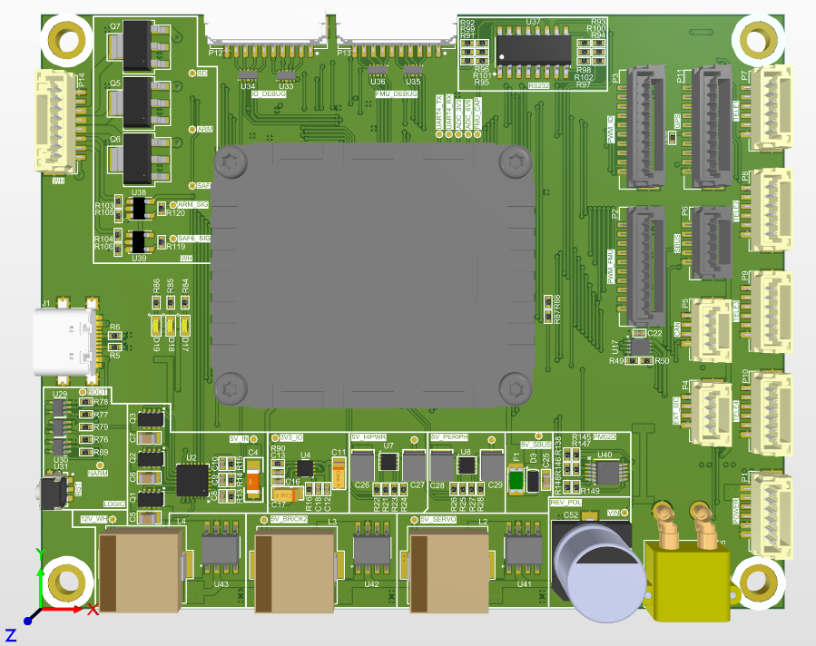
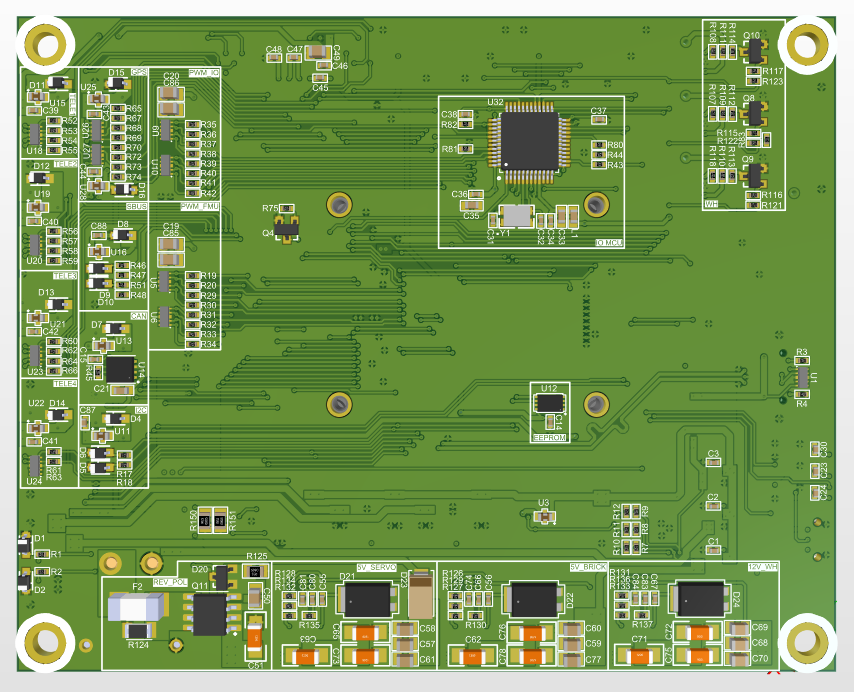

# Pixhawk 6X Carrier Board

## معرفی پروژه

این پروژه شامل طراحی و توسعه یک Carrier Board اختصاصی برای ماژول کنترل پرواز Pixhawk 6X است که با هدف توسعه رابط‌های ارتباطی، مدیریت منابع تغذیه و فراهم‌کردن قابلیت اتصال و کنترل تجهیزات جانبی طراحی شده است.

در طراحی این برد، رابط‌های ارتباطی متنوعی شامل USB، SBUS، UART، I2C و CAN در نظر گرفته شده است. همچنین بخش مدیریت توان با قابلیت دریافت ورودی تا 60 ولت و سه منبع تغذیه مستقل 5 ولت طراحی شده که هرکدام برای تأمین توان بخش مشخصی از سیستم در نظر گرفته شده‌اند.

یکی از بخش‌های مهم این طراحی، مدار Power Sequencer است که وظیفه اولویت‌بندی و انتخاب بین سه ورودی تغذیه را بر عهده دارد. علاوه بر این، سوییچ‌های الکترونیکی مبتنی بر MOSFET با قابلیت عبور جریان تا 20 آمپر برای کنترل مستقل تغذیه تجهیزات جانبی طراحی شده‌اند.

## قابلیت‌ها و مشخصات فنی

- **ماژول اصلی:** Pixhawk 6X
- **تعداد لایه‌های PCB:** چهار لایه (4-Layer PCB)
- **حداکثر ولتاژ ورودی:** 60V
- **تعداد منابع تغذیه 5V:** سه منبع مستقل
- **ظرفیت جریان هر منبع 5V:** حداکثر 5A
- **مدیریت منابع تغذیه ورودی:** Power Sequencer با قابلیت اولویت‌بندی سه ورودی
- **سوییچ‌های الکترونیکی:** مبتنی بر MOSFET با قابلیت عبور جریان تا 20A
- **رابط‌های ارتباطی:** USB، SBUS، UART، I2C و CAN
- **کنترل تجهیزات جانبی:** سوییچ‌های مستقل تغذیه مبتنی بر MOSFET

## ملاحظات و چالش‌های طراحی سخت‌افزار

### 1. طراحی رابط‌های ارتباطی

- توسعه رابط USB برای ارتباط با سیستم‌های جانبی
- طراحی رابط‌های UART برای ارتباط با تجهیزات و ماژول‌های جانبی
- فراهم‌کردن رابط I2C برای اتصال سنسورها و تجهیزات جانبی
- توسعه رابط CAN برای ارتباط با تجهیزات مبتنی بر این پروتکل
- طراحی رابط SBUS برای دریافت سیگنال‌های کنترلی

### 2. طراحی سیستم مدیریت توان (Power Management)

- طراحی ورودی تغذیه با قابلیت پشتیبانی از ولتاژ تا 60 ولت
- طراحی سه منبع تغذیه مستقل 5V با قابلیت تأمین جریان 5A برای هر منبع
- اختصاص منابع تغذیه مستقل به بخش‌های مختلف سیستم
- طراحی ساختار توزیع توان متناسب با نیاز مصرف‌کننده‌های مختلف
- در نظر گرفتن الزامات طراحی مدارهای تغذیه با ولتاژ ورودی بالا

### 3. طراحی Power Sequencer

- طراحی مدار Power Sequencer برای اولویت‌بندی و مدیریت سه ورودی تغذیه
- طراحی منطق انتخاب منبع تغذیه بر اساس اولویت تعیین‌شده
- مدیریت مسیرهای ورودی توان و انتخاب منبع مناسب برای تأمین انرژی سیستم

### 4. طراحی سوییچ‌های الکترونیکی مبتنی بر MOSFET

- طراحی سوییچ‌های الکترونیکی برای کنترل مستقل تغذیه تجهیزات جانبی
- استفاده از MOSFET با قابلیت عبور جریان تا 20 آمپر
- طراحی مدارهای راه‌انداز و کنترل سوییچ‌های قدرت
- فراهم‌کردن امکان قطع و وصل مستقل مسیرهای تغذیه مصرف‌کننده‌های جانبی

### 5. طراحی PCB

- طراحی PCB چهار لایه
- بهینه‌سازی مسیرهای تغذیه متناسب با جریان‌های عبوری
- مدیریت مسیرهای جریان بالا و توزیع توان
- رعایت ملاحظات مربوط به نویز و تداخل الکترومغناطیسی در بخش‌های قدرت و سیگنال

## تصاویر سه‌بعدی طراحی PCB

### نمای روی برد (Top View)

### نمای زیر برد (Bottom View)

## ابزارهای طراحی و توسعه

- Altium Designer

## حوزه‌های تخصصی

Hardware Design | Pixhawk 6X | Carrier Board Design | Power Management | Power Sequencing | DC-DC Power Supply | High Voltage Power Input | MOSFET Power Switching | High Current PCB Design | USB | UART | I2C | CAN Bus | SBUS | PCB Design | Embedded Systems
