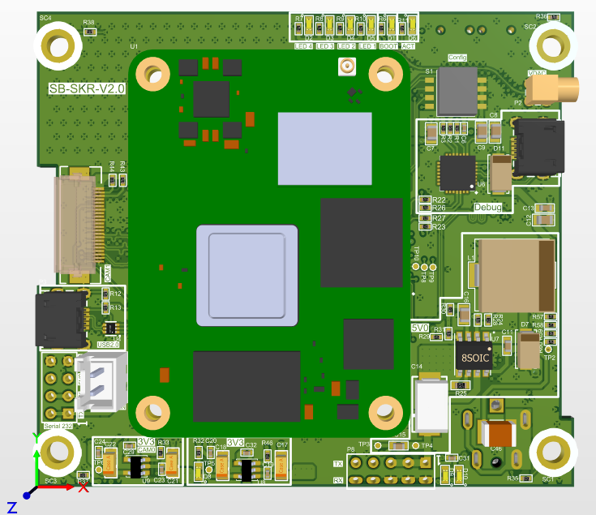
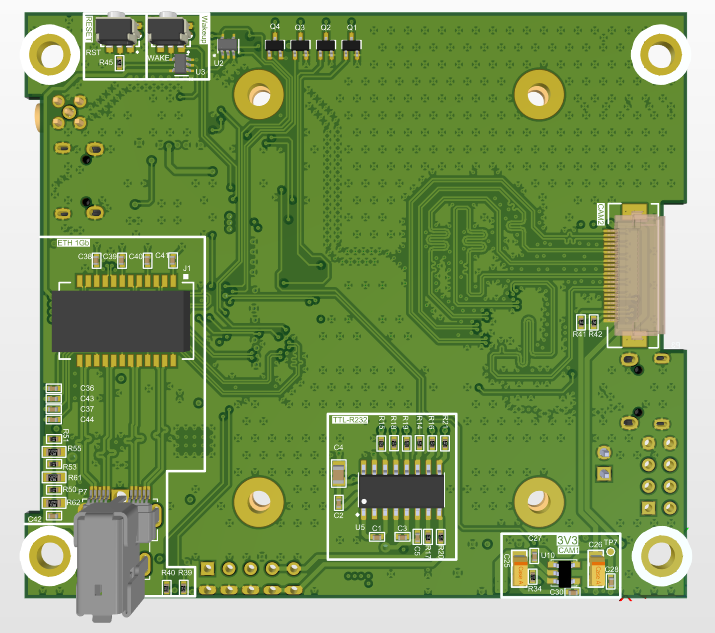

# طراحی برد توسعه Raspberry Pi CM4 / CM5

## معرفی پروژه

این پروژه شامل طراحی و توسعه یک برد Carrier اختصاصی برای ماژول‌های **Raspberry Pi Compute Module 4 و Compute Module 5** است که با هدف ایجاد یک پلتفرم سخت‌افزاری یکپارچه، انعطاف‌پذیر و قابل استفاده در سیستم‌های Embedded و کاربردهای پردازش تصویر طراحی شده است.

در طراحی این برد، مجموعه‌ای از رابط‌های ارتباطی، زیرساخت تغذیه، رابط‌های دوربین و امکانات توسعه و عیب‌یابی در نظر گرفته شده است تا امکان استفاده از قابلیت‌های Compute Module در کاربردهای مختلف فراهم شود.

## قابلیت‌ها و مشخصات فنی

- **پشتیبانی از CM4 و CM5:** طراحی برد به‌عنوان یک پلتفرم توسعه و واسط سخت‌افزاری برای ماژول‌های Raspberry Pi Compute Module 4 و 5.
- **ارتباط شبکه Gigabit Ethernet:** بهره‌مندی از رابط شبکه با سرعت 10/100/1000 Mbps برای تبادل داده و ارتباطات شبکه‌ای پرسرعت.
- **رابط UART Debug:** پیاده‌سازی مسیر اختصاصی دیباگ UART با استفاده از مبدل USB-to-Serial و انتقال خروجی کنسول به کامپیوتر از طریق USB.
- **قابلیت USB Boot:** استفاده از مکانیزم USB Boot داخلی Compute Module برای نصب سیستم‌عامل و برنامه‌ریزی حافظه ماژول.
- **دو رابط دوربین CSI:** مجهز به دو درگاه MIPI CSI برای اتصال ماژول‌های دوربین و پیاده‌سازی سیستم‌های پردازش تصویر چنددوربینه.
- **پشتیبانی از لنز موتورایز:** در نظر گرفتن زیرساخت سخت‌افزاری لازم برای اتصال و کنترل لنزهای موتورایز در کاربردهای تصویربرداری.
- **ورودی تغذیه تا 36 ولت:** طراحی بخش تغذیه با قابلیت دریافت ولتاژ ورودی تا 36V برای انعطاف‌پذیری در تأمین انرژی سیستم.
- **طراحی PCB چهار لایه:** استفاده از ساختار چهارلایه با هدف بهبود مسیریابی سیگنال‌ها، توزیع توان و دستیابی به طراحی فشرده و منظم.

## ملاحظات و چالش‌های طراحی سخت‌افزار

با توجه به وجود رابط‌های پرسرعت در این برد، بخش قابل‌توجهی از فرآیند طراحی PCB به رعایت الزامات Signal Integrity و کنترل کیفیت مسیرهای سیگنال اختصاص داشته است.

مهم‌ترین ملاحظات طراحی عبارت‌اند از:

### 1. طراحی و مسیریابی رابط‌های MIPI CSI

- رعایت امپدانس کنترل‌شده (Controlled Impedance) در مسیرهای تفاضلی MIPI D-PHY.
- انجام Length Matching بین زوج‌سیگنال‌های تفاضلی و رعایت محدودیت‌های تطبیق طول بین Laneها مطابق الزامات رابط.
- حفظ پیوستگی مسیر بازگشت جریان (Return Path) و جلوگیری از عبور سیگنال‌های پرسرعت از نواحی دارای تغییرات نامناسب در صفحه مرجع.
- مدیریت Via Transitionها و کاهش تعداد تغییر لایه در مسیرهای پرسرعت.
- توجه به Crosstalk و فاصله‌گذاری مناسب بین مسیرهای تفاضلی.
- طراحی مناسب نواحی اتصال کانکتورهای CSI با در نظر گرفتن پیوستگی امپدانس و کیفیت انتقال سیگنال.

### 2. طراحی رابط Gigabit Ethernet

- رعایت امپدانس تفاضلی کنترل‌شده، معمولاً 100 اهم، در مسیرهای زوج‌سیگنال Ethernet.
- توجه به تطبیق طول مسیرهای تفاضلی و حفظ تقارن الکتریکی زوج‌سیگنال‌ها.
- مدیریت مسیرهای سیگنال بین PHY، مدارهای واسط و کانکتور شبکه با توجه به معماری پیاده‌سازی‌شده.
- رعایت اصول طراحی Return Path و جلوگیری از ایجاد ناپیوستگی در مسیر بازگشت جریان.
- استفاده اصولی از Ground Stitching Via در نواحی موردنیاز برای بهبود پیوستگی زمین و مدیریت مسیر بازگشت جریان.
- رعایت فاصله‌گذاری مناسب بین مسیرهای Ethernet و سایر سیگنال‌های حساس به‌منظور کاهش تداخل الکترومغناطیسی.

### 3. طراحی ساختار چهارلایه PCB

- انتخاب Stack-up مناسب با در نظر گرفتن نیازهای امپدانس کنترل‌شده و مسیرهای پرسرعت.
- اختصاص صفحات مرجع مناسب برای مسیرهای سیگنال و حفظ پیوستگی صفحات زمین.
- مدیریت توزیع توان و زمین در لایه‌های مختلف.
- بهینه‌سازی مسیریابی برای کاهش تداخل متقابل و حفظ کیفیت سیگنال‌ها.

### 4. طراحی بخش تغذیه

- طراحی ورودی تغذیه با قابلیت تحمل ولتاژ تا 36V.
- توجه به مسیرهای جریان، پهنای ترک‌ها و توزیع مناسب توان.
- در نظر گرفتن الزامات نویز و پایداری تغذیه برای بخش‌های حساس دیجیتال و رابط‌های ارتباطی.

## تصاویر سه‌بعدی طراحی PCB

### نمای روی برد (Top View)

### نمای زیر برد (Bottom View)

## ابزار طراحی

- Altium Designer

## حوزه‌های تخصصی

Hardware Design | PCB Design | High-Speed Signal Routing | Signal Integrity | Embedded Systems | Raspberry Pi | Computer Vision
